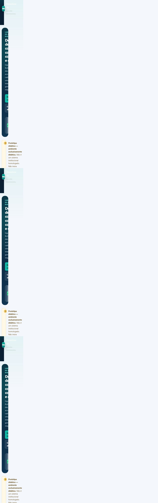
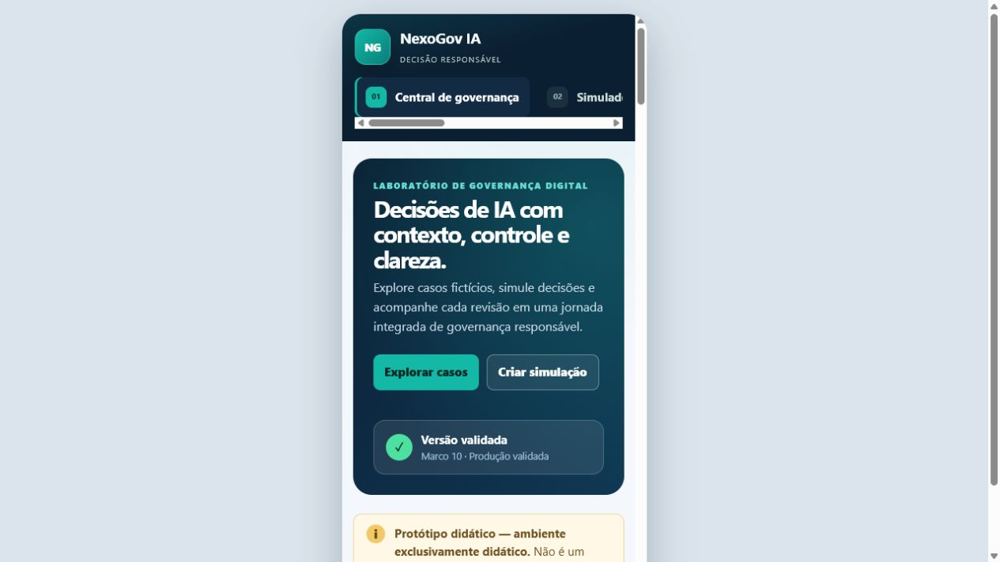

# Evidências finais — Piloto IA 06

As capturas abaixo registram a identidade autoral **NexoGov IA**, evolução visual do projeto acadêmico GOVSAFE 360, usando dados exclusivamente fictícios.

## Aplicação publicada

- Produção: <https://govsafe360-u06-blush.vercel.app/>
- Commit da identidade NexoGov IA: `58c89fe57c34e54a4563bd5b35649dbe5850b042`
- Pull Request final: <https://github.com/jonathanxaxo/govsafe360-u06/pull/2>

## Visualização desktop

## Visualização móvel

## Validação

Em 16/10/2026, `npm run quality` foi executado novamente com aprovação integral da sintaxe, build, sincronização, política, cenários, auditoria, qualidade e validações dos marcos M9 e M10.

A validação visual confirmou o layout responsivo e a integração entre os indicadores, filtros, biblioteca de casos, revisão humana e trilha de auditoria.

Estas imagens não contêm credenciais, informações pessoais ou dados institucionais reais.
